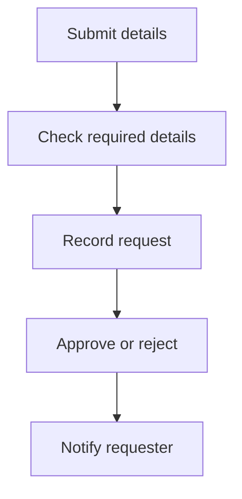

---
prev:
  text: Back
  link: /preparation
next:
  text: Exercise 2 · Play the Flow-card challenges
  link: /exercises/02-arrange-flow-cards
---

# Exercise 1 · Find a bottleneck

## Goal
Map a training request, match its business roles and choose one small improvement with a human checkpoint.

## What you need
Flipchart, post-its and markers. No software account or paid licence.

**Scenario:** An internal training request includes a topic, date, participant count and business reason. It moves from submission through a details check, a register entry and a decision, then the outcome is communicated. Sometimes details are missing, information is copied again, or people ask for status while waiting.

## Steps

### Practice 1 · Map the work {#practice-1-·-map-the-work}

Recreate the five-step training-request flow on your flipchart.

1. Write each of the five steps on a separate post-it.
2. Place them in the shown order and draw arrows between them.
3. Follow one training request from submission to notification. Add role labels in the next practice.

**Check your result:** Your map has the five steps in order, with a clear start and finish.

### Practice 2 · Match the roles {#practice-2-·-match-the-roles}

Match the business roles to the steps on your map.

Choose from this role bank:

- **Requester**
- **Coordinator**
- **Manager**

1. Discuss which role is responsible for each step.
2. Write the role on a post-it and place it below the matching step. A role may appear more than once.
3. Explain what information passes from one step to the next.
4. Ask a teammate to follow the map and explain the handovers.

**Check your result:** Every step has a role, and your group can explain why it fits.

### Practice 3 · Find the bottleneck {#practice-2-·-find-the-bottleneck}

Identify two places where work slows down or mistakes happen.

Discuss where the process becomes difficult:

1. Mark at least two bottlenecks, such as missing request details, repeated copying into the register, waiting for a decision or repeated status enquiries.
2. Explain what causes each problem and who is affected.
3. Write a possible cause of each bottleneck on a separate post-it. Attach it beside the affected step.

**Check your result:** Each marked bottleneck has a post-it explaining its possible cause.

### Practice 4 · Choose one improvement {#practice-3-·-choose-one-improvement}

Define a small automation-supported change with a human checkpoint.

Choose an improvement and reflect on what still needs human judgement:

1. Choose one bottleneck to improve.
2. Describe one repeatable change, such as reusing a message asking for missing training details or reducing repeated copying.
3. Name the role that checks the information and result. The manager keeps responsibility for approving or rejecting the request.
4. Explain the expected improvement in one sentence.

**Check your result:** Keep the five-step map with role labels, two bottleneck marks and one improvement with a named checking role.

### Practice 5 · Invite the inquisitor {#practice-4-·-invite-the-inquisitor}

Give your training-request improvement a friendly cross-team challenge.

1. Choose one teammate as your **Inquisitor**.
2. Send your Inquisitor to another team's flipchart.
3. The host team explains the chosen bottleneck, the improvement and the human checkpoint.
4. The Inquisitor chooses one curious question:
   - **Why this improvement?**
   - **What could go wrong?**
   - **Who checks the result?**
5. If the explanation is clear, the Inquisitor signs the flipchart. If not, improve the explanation and try again.
6. Return to your team and welcome a visiting Inquisitor to your own flipchart.

**Check your result:** Your flipchart has a visiting Inquisitor's signature, and your team can explain why the improvement is useful.

The signature confirms that the explanation is clear. It does not prove technical feasibility or production readiness.

::: details Discussion help
Ask: What is repeated? Which detail is missing? Where does the request wait? What needs a human decision? A flow is like a recipe: clear steps help work repeat, while a person checks whether the result is suitable.
:::
