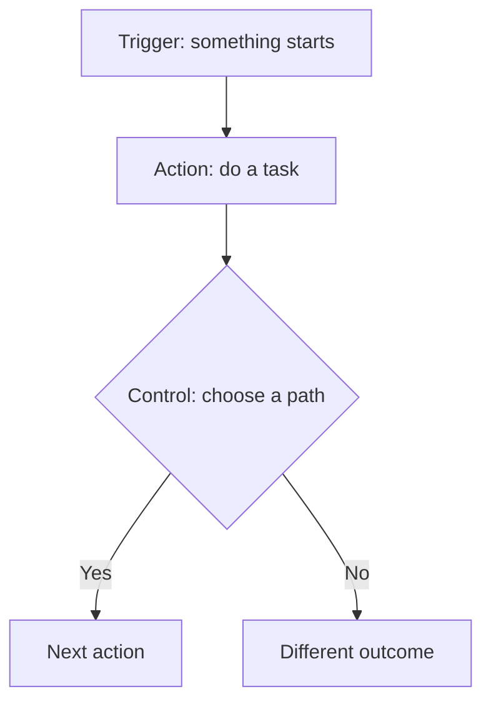

---
prev:
  text: Back
  link: /exercises/01-spot-bottleneck
next:
  text: Continue
  link: /exercises/03-build-information-request
---

<section class="course-hero exercise-hero" aria-labelledby="exercise-2-·-play-the-flow-card-challenges">

# Exercise 2 · Play the Flow-card challenges

## Goal
Compose a flow with the supplied cards and explain how it reaches the normal outcome in your chosen challenge’s **Checkpoint**.

</section>

## What you need
A complete usable supplied card set per group, flipchart and post-its. No software account, paid licence or printed worksheet.

## Steps

### Practice 1 · Get to know the cards

Recognise each card's job in the instructor's short, unscored example.

1. Find a **Trigger**: the event that starts the flow.
2. Find an **Action**: a task the flow performs.
3. Find a **Control**: a way to choose a path or repeat steps.
4. Explain the example back to a partner.

**Read these cards as follows:**

- **Start and wait for an approval — Action.** A person makes the approval decision. The supplied card incorrectly labels it as a Trigger.
- **Get Attachment (V2)** — retrieves one attachment's content. Repeat the attachment steps when an email contains more than one attachment. The supplied card prints “Get Attachments (V2)” with an extra **s**.

Use the supplied physical cards unchanged; follow the corrected names and roles above.

**Check your result:** You can explain Trigger, Action and Control in your own words.

### Practice 2 · Build and explain challenges

Arrange a basic flow and explain the normal outcome described under **Required for 1 point**.

1. Choose a challenge together. **Start with Challenge 4 or 5** if unsure.
2. Read **Scenario → Challenge → Checkpoint**. Focus on **Required for 1 point**.
3. Arrange the supplied cards to show the start, steps and expected result.
4. Follow the information through your flow together. Include any repeated steps or human approval.
5. Show and explain your flow to the instructor/TA. Ask for hints and retry as needed.
6. When accepted, the instructor/TA records **1 point**. Reuse the cards for another challenge and take turns moving them.

Build your flow using only the supplied physical Flow cards. Use post-its for information, responsible roles, decisions, destinations, repeated use of an existing card and unresolved checks. Do not invent new Trigger or Action cards.

**Optional discussion** in each Checkpoint explores the other outcome or a technical limitation. Try it if you wish; it is not required for the point and earns no extra points.

**Check your result:** The instructor/TA can follow your valid starting Trigger and connected supplied cards to the normal outcome under **Required for 1 point**. Necessary repetition, information handoffs and human approval are present; an unfinished optional path does not block the point.

#### Choose a challenge

- [Challenge 1 — Email attachment intake](/challenges/01)
- [Challenge 2 — Monthly review and approval](/challenges/02)
- [Challenge 3 — Field-support request routing](/challenges/03)
- [Challenge 4 — Internal resource approval](/challenges/04)
- [Challenge 5 — Teams service-request routing](/challenges/05)
- [Challenge 6 — Controlled-document approval](/challenges/06)

## Scoring

- **Earn 1 point when the instructor/TA accepts your starting Trigger, connected cards and the outcome under Required for 1 point in the challenge’s Checkpoint.**
- Each challenge earns a point only once. **Maximum: 6 points per group.** Optional branches and technical-limit discussions do not affect your score or earn extra points.
- Ask for hints and retry as often as needed, with no deductions or partial points. Finishing faster earns no extra points.
- Attempt as many challenges as you choose; completing all six is optional.
- The group with the most points wins. Groups tied for the highest score share the win.

## Discussion
Share selected arrangements and scores. Explain how the components work together and name one human checkpoint. After lunch, you will build a smaller two-step email flow yourself.

[Open the challenge board →](/challenges/)

## Continue

[Continue →](/exercises/03-build-information-request)
