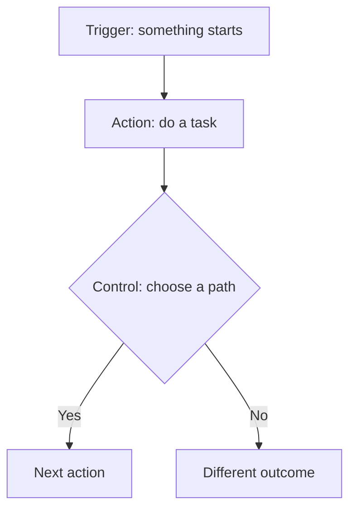

---
prev:
  text: Back
  link: /exercises/01-spot-bottleneck
next:
  text: Continue
  link: /exercises/03-build-information-request
---

# Exercise 2 · Play the Flow-card challenges

**10:45–12:00 · Group paper simulation**

## Goal
Explain how cards could move a normal case from a starting event to a useful outcome.

## What you need
A complete usable supplied card set per group, flipchart and post-its. No software account, paid licence or printed worksheet.

## Steps

### Practice 1 · Get to know the cards — 10:45–11:00
Recognise each card's job in the instructor's short, unscored example.

1. Find a **Trigger**: the event that starts the flow.
2. Find an **Action**: a task the flow performs.
3. Find a **Control**: a way to choose a path or repeat steps.
4. Explain the example back to a partner.

**Card corrections:** The printed `Start and wait for an approval` card is an **Action**, even if labelled Trigger. The printed `Get Attachments (V2)` refers to the product action `Get Attachment (V2)`, which retrieves one attachment's content. Keep the cards unchanged.

**Check your result:** You can explain Trigger, Action and Control in your own words.

### Practice 2 · Build and explain challenges — 11:00–11:50
Arrange a plausible basic sequence and show its normal result.

1. Use **11:00–11:10** to read the [six-challenge board](/challenges/) and agree roles: reader, arranger, explainer and checker.
2. Choose any challenge. **Start with Challenge 4 or 5** if unsure.
3. During **11:10–11:50**, read its normal case, arrange cards and add notes for inputs, people and destinations.
4. Walk the case through every step. Request an instructor/TA check.
5. After acceptance, record the point on the shared board. Reuse the cards for another challenge and rotate roles.

Use only available physical cards. Post-its may explain roles, inputs, decisions or repeated uses of an existing card; do not invent new Actions.

**Check your result:** A valid starting Trigger, connected available cards and an explanation showing how the normal case reaches its intended outcome.

## Scoring

- **One point per accepted challenge, up to six points.** Each challenge scores only once.
- Hints and retries are welcome, with no deductions. No partial points or speed bonuses.
- All six are optional. Equal highest scores share the result; no tie-break penalties.
- Optional exceptions, detailed fields and technical-limit recall earn no extra points.
- Required normal behaviour still matters: both attachments must be saved, and approvals remain human decisions.

The score shows a **basic paper simulation**, not full solution correctness, tenant readiness or individual hands-on competence.

## Discussion — 11:50–12:00
Share selected arrangements and scores. Explain one human checkpoint. After lunch, you will build a smaller two-step email flow yourself.

[Open the challenge board →](/challenges/)

## Continue

[Continue →](/exercises/03-build-information-request)
