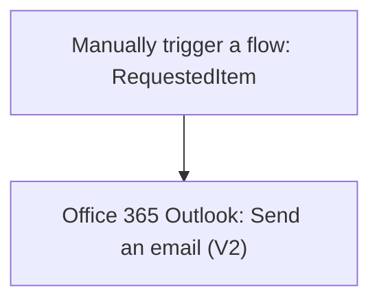

---
prev:
  text: Back
  link: /exercises/02-arrange-flow-cards
next:
  text: Continue
  link: /exercises/04-ai-coaching
---

# Exercise 3 · Build an email flow


## Goal

In the morning, your group mapped how a coordinator follows up on missing weekly-report information. Now reduce the repeated typing: build a reusable request email with one blank for the missing item. You decide what to request and check the recipient before running it.

**Goal:** Build a two-step flow, then receive two emails that match two different inputs. Use fictional information and send both emails to your own work mailbox for practice.

**Time:** 13:00–14:30. Each person uses their own organisational work account and work mailbox.

> **License:** This lab uses the Standard Office 365 Outlook connector. Power Automate cloud-flow entitlement, Exchange Online mailbox access and organisational permissions must be confirmed before training. The design requires no Premium connector or paid Copilot add-on.

## What you need

Have a computer, browser, approved environment and your own Outlook connection. Read [Setup and troubleshooting](/preparation). Keep [email copy](/downloads/email-copy.txt) and [test inputs](/downloads/test-inputs.txt) available. Use fictional content and send only to yourself; never share accounts.



## Steps

### Orientation and demonstration — 13:00–13:20

Use ten minutes to open Power Automate and Outlook and check identity/environment with the instructor. Watch a ten-minute demonstration. The input is the value supplied at run time; Dynamic content passes that value into the email. Save stores the instructions; Run sends a real practice email.

### Practice 1: Create the manual trigger — 13:20–13:35

**Primary target:** Create a manual trigger with one required Text input for the missing report item.

1. Open Power Automate with your work account and check the organiser-approved environment:

   ```text
   https://make.powerautomate.com
   ```

2. Select **Create** → **Instant cloud flow**. Enter this **Flow name**:

   ```text
   B3-MyInformationRequest
   ```

3. Select **Manually trigger a flow**, then **Create**.
4. Select the trigger card. In **Parameters**, select **Add an input** → **Text**. Change the input name from Text to:

   ```text
   RequestedItem
   ```

5. Check the input menu. If it offers **Make the field optional**, the input is currently required. If it offers **Make the field required**, select that option. Ask the instructor if your menu differs.
6. Stay in the same designer and continue to Practice 2. Add the email action before saving the complete flow.

#### Check your result

The trigger has exactly one Text input named RequestedItem, set as required. You can explain what a person will enter when they run it.

### Practice 2: Configure the email with Dynamic content — 13:35–13:50

**Primary target:** Configure and save an email action that uses the trigger's input in its request line.

1. Select **+** below the trigger → **Add an action**. Search:

   ```text
   Send an email (V2)
   ```

2. Select **Send an email (V2)** under **Office 365 Outlook**, not Outlook.com. If asked to sign in, use your own organisational work account.
3. In **To**, enter your own work email and check the complete address. Leave CC/BCC empty. Keep this recipient fixed; do not add a recipient input.
4. Paste this **Subject**:

   ```text
   [TRAINING] Information request for weekly report
   ```

5. Paste this **Body**:

   ```text
   Hello,

   Please provide:
   This information is for the weekly report.
   If it is not ready, please tell me the expected delivery date.

   Thank you.
   This is a training message.
   ```

6. Click immediately after `Please provide:` in **Body** and type one space.
7. Open **Dynamic content** using the lightning button. Alternatively, type `/` and select **Insert dynamic content** if your designer offers it.
8. Search for and select `RequestedItem` under **Manually trigger a flow**. Keep the surrounding email text unchanged.
9. Check that the request line contains one inserted token. Do not type the word RequestedItem or a sample requested item into that blank. Keep one trigger and one email action, with no attachments or changed From.
10. Select **Save** and resolve any reported issue before testing.

> **Think of a reusable letter:** The token marks the blank; the value you enter at Run fills it. Typing the input's name would print that name in every email instead.

#### Check your result

The flow saves with your own work email in To, CC/BCC empty and the RequestedItem token after “Please provide:”. The coordinator still chooses the item and checks the recipient.

### Practice 3: Test and compare two results — 13:50–14:20

**Primary target:** Verify that changing the run-time input changes the received request without editing the email action.

#### Test A — 13:50–14:05

1. Predict one email to yourself with this requested item:

   ```text
   List of outstanding tasks
   ```

2. Select **Test** → **Manually** → **Test**. If a connection check appears, confirm that Office 365 Outlook uses your own work account. Continue only when the connection is ready; ask the instructor if it is wrong or blocked.
3. Enter the value above in `RequestedItem`. Check the value and your recipient, then select **Run flow** once.
4. Wait for completion. Open the flow details and **Run history**, then inspect the relevant run and its action result.
5. Open Outlook. Check Inbox/Junk, recipient, subject and request line against the expected request line: `Please provide: List of outstanding tasks`. Use the run time to identify the correct message.
6. Record the input, run time, status and actual email result in your own notes. If the email is missing, investigate before running again.

#### Check your result

Run history and a received email support the result for input A. If you only watched a demonstration, record that you have not run your own flow.

#### Test B — 14:05–14:20

1. Predict that the recipient, subject and surrounding message stay the same.
2. Test again with this `RequestedItem`:

   ```text
   Expected completion date
   ```

3. Run once, wait, and check Run history and the received email against the expected request line: `Please provide: Expected completion date`.
4. Compare messages A and B on your own screen. Ask a partner to point out the change while you retain control of the account. Check that B contains neither A's item nor the literal word RequestedItem.
5. Record the second result separately. If a correction is needed, fix, Save and test again; identify the extra run as a correction rather than replacing the first record.

#### Check your result

Two received emails match the two inputs. Explain where the token gets its value and where that value appears.

## Support and recap — 14:20–14:30

Help a partner identify checkpoints if you finish early. Do not add connectors or features. This flow does not identify missing information, read replies or prevent duplicates; each run can send another email. After the break, AI can help explain a question, while you remain responsible for checking the result.


::: details Help: different controls, wrong text or missing email

- **Save draft / Publish shown:** Your environment may create solution-aware flows. Ask the instructor to confirm the approved save/publish route before testing; do not create a Solution just to match another guide.
- **Wrong connection:** Stop before Run. Ask the instructor to select or establish your own approved connection. Never use another learner's account.
- **RequestedItem missing or printed literally:** Check the trigger input name, reopen Dynamic content from Body and insert its token. Do not use Expression.
- **Both emails contain the first item:** Remove the fixed item from the request line and insert the token. Save and retest; record the correction separately.
- **No email:** Check the relevant run time/status, recipient and Inbox/Junk before retrying. Each run can send another email.

If access is blocked, follow the demonstration and mark individual build/run as incomplete. See [Setup and troubleshooting](/preparation).

:::


[Microsoft designer guidance](https://learn.microsoft.com/power-automate/flows-designer)

## Continue

[Continue to Exercise 4 →](/exercises/04-ai-coaching)
